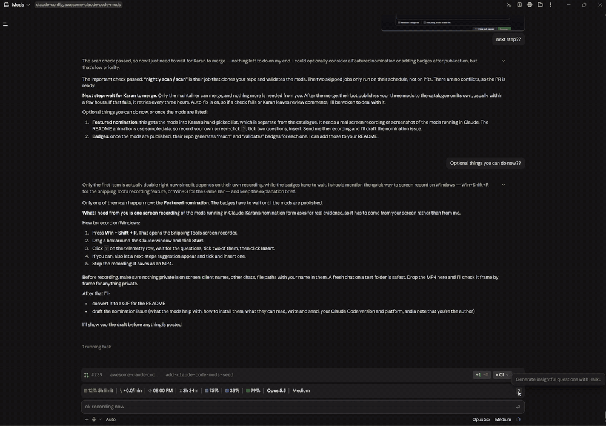
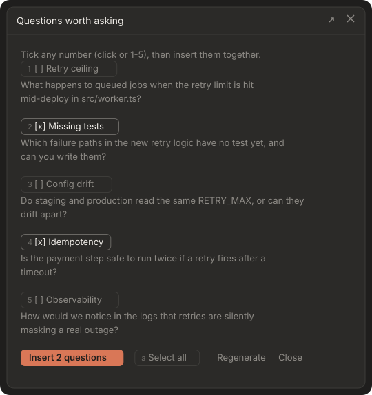
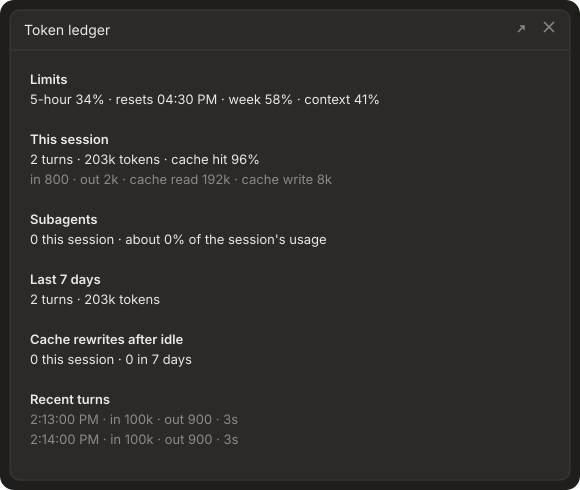
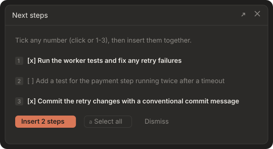

# Claude Code mods

[](https://github.com/bully911210/claude-code-mods/actions/workflows/ci.yml)
[](LICENSE)

Three function-hook mods for Claude Code:

- **token-ledger** puts your plan limits in one row above the prompt and adds a `?` button that asks Haiku what you should ask next.
- **next-steps** suggests your next prompts after each turn.
- **auto-docs** keeps your README in step with every commit.

Every picture below was rendered from the element trees these mods really return, recorded with the Claude Code plugin test kit. They show what you get, not a mock-up. **[Try the interactive demo →](https://bully911210.github.io/claude-code-mods/)**

**Real recording** (Claude Code 2.1.295 desktop app, Windows 11): click `?`, Haiku writes five questions about this conversation, tick three, and insert them into the prompt box together.

<p align="center">
  
</p>

**Rendered from the mod's own draw output:**

<p align="center">
  
</p>

| Mod | What you get | Commands |
| --- | --- | --- |
| [token-ledger](#token-ledger) | A telemetry row above the prompt (5-hour %, burn rate, reset, time left, weekly %, context %, cache hit %, model, effort). A `?` button for five Haiku questions. A `/ledger` pane. A `/brief` pane for what it has learned about you and your project. | `/ask`, `/ledger`, `/brief` |
| [next-steps](#next-steps) | 1-3 suggested next prompts after each real turn, in a pane of their own. | `/next`, `/next off`, `/next on` |
| [auto-docs](#auto-docs) | After each commit, a follow-up `docs: sync with <sha>` commit that updates README.md, or the docs you list. | `/docs`, `/docs <commit>` |

Both panes are **multi-select**. Tick as many rows as you like by clicking or pressing `1`-`5`. Use **Select all** (`a`) or **Clear** (`c`), then **Insert** (`i`). The ticked text goes into the prompt box in the order you ticked it, one blank line apart, and is never sent for you. Anything you had already typed stays.

---

## token-ledger

### The telemetry row


From left to right:

- 5-hour limit % (orange)
- burn rate
- when the 5-hour window resets
- time left
- weekly limit % (blue)
- context window % (purple)
- cache-hit % (green)
- model
- effort

Every figure comes from the engine's own readings. A metric with no reading is left out, never faked. On a narrow window, secondary metrics drop out so the row stays on one line. It shows **percentages, never money**. The row appears after the session's first reply, because that's when the first limit figures arrive.

### `?`: questions worth asking

Click `?` at the end of the row, or run `/ask`. Haiku 5.5 reads the project (folder, git branch, status and recent commits, CLAUDE.md), Claude's visible reasoning, and the chat. It writes five specific questions you haven't explored yet, which open in their own pane, so the row above the prompt never moves.



### `/brief`: what `?` has learned

`?` does not start cold. After each prompt you type, a small Haiku call folds the exchange into three things the mod keeps on your machine:

- **A project brief:** what the project is, the goal, what has been decided and what is still open. One per project folder.
- **A profile of you:** who you are, your business, how you like to be spoken to. Shared across projects.
- **Feedback:** things you corrected, moments you were frustrated, and which suggestions you inserted or skipped.

`?` then reads that memory plus the latest messages, so its questions fit your project and don't repeat what you have already decided or skipped. Until a brief exists, `?` still gets the full recent chat.

`/brief` shows what the mod believes so you can correct it:

| Command | What it does |
| --- | --- |
| `/brief` | Opens the pane. |
| `/brief brief <text>` | Replaces this project's brief. |
| `/brief profile <text>` | Replaces your profile. |
| `/brief forget` | Clears this project's feedback log. |
| `/brief reset` | Clears this project's brief and feedback. Your profile is kept. |

Privacy: ID numbers, phone numbers, email addresses and card numbers are replaced with stable tokens before anything is stored or sent to Haiku. Only prompts a person typed are learned from, never notifications, schedules or peer messages. Everything is stored locally in the plugin's own store. A manual `/brief brief` edit can be rewritten by a later turn's fold, so re-run it if a fact must stay.

### `/ledger`



The pane shows:

- your limits
- this session's tokens and cache-hit rate
- each subagent's share of the session
- the last 7 days
- **cache rewrites after idle**: turns where the prompt cache expired and had to be rewritten

**Settings** (`/config`, or `pluginConfigs` in settings.json):

| Setting | Default | What it does |
| --- | --- | --- |
| `agentAlertPercent` | `10` | Shows a toast when one subagent has used about this much of your 5-hour limit. `0` turns it off. |
| `animations` | on | Off draws a still row. |
| `toastOnCacheMiss` | on | Shows a toast when a turn after an idle gap rewrote the prompt cache. |

---

## next-steps

After a real turn (a long answer, or one that used 3 or more tools), Haiku suggests 1-3 prompts you could send next. They open in their own pane.

<p align="center">
  
</p>



Before anything is sent to Haiku, these are replaced with stable tokens:

- ID numbers
- phone numbers
- email addresses
- card numbers

The scrubbing covers file and project names too.

| Setting | Default | What it does |
| --- | --- | --- |
| `model` | `haiku` | `haiku` or `sonnet`. |
| `minAnswerChars` | `300` | Skips suggestions after shorter answers, unless the turn made 3 or more tool calls. |

---

## auto-docs

When the session runs a `git commit`, auto-docs reads the diff and asks the model for the smallest edits that make your docs true again. It applies them as exact find-and-replace edits, so it never rewrites a whole file, and commits them separately.

<p align="center">
  
</p>

- An edit is applied only when the text it replaces appears **exactly once**. Any edits it skips are reported.
- It skips commits marked `[skip docs]`, `docs:` commits, and commits that only touch documentation.
- It **never pushes**.
- It only sees commits this session makes. For commits made elsewhere, run `/docs` or `/docs <commit>`.

| Setting | Default | What it does |
| --- | --- | --- |
| `docs` | `README.md` | Comma-separated paths from the repository root. |
| `mode` | `commit` | `commit` makes a separate docs commit. `stage` leaves the changes staged for you to review. |
| `model` | `sonnet` | The model that reads the diff. |
| `maxDiffChars` | `60000` | Larger diffs are cut down by whole files. |

---

## Install

These are function-hook plugins (a `hooks/register.tsx` module), so you need a Claude Code build that supports them. They were built and tested on 2.1.29x.

**From the marketplace** (in a Claude Code session):

```
/plugin marketplace add bully911210/claude-code-mods
/plugin install token-ledger@claude-code-mods
/plugin install next-steps@claude-code-mods
/plugin install auto-docs@claude-code-mods
```

**Or from a clone.** Point `CLAUDE_CODE_PLUGIN_DIRS` in the `env` block of `~/.claude/settings.json` at the folders you want (use `;` between them on Windows, `:` elsewhere):

```json
{
  "env": {
    "CLAUDE_CODE_PLUGIN_DIRS": "/path/to/claude-code-mods/token-ledger:/path/to/claude-code-mods/next-steps:/path/to/claude-code-mods/auto-docs"
  }
}
```

Plugin folders load when a session starts, so **fully quit and reopen Claude** after installing or changing them.

## Develop

```bash
claude plugin validate token-ledger
claude plugin test token-ledger
```

Each mod has its own `tests/`. To redraw the README pictures after changing a view:

1. Copy `docs/capture/<mod>.capture.ts` into that mod's `tests/` folder.
2. Run `claude plugin test <mod>`, and save the lines that start with `CAPTURE ` (without that prefix) to `docs/capture/<mod>.jsonl`.
3. Run `python docs/tools/render.py`.

The interactive demo (`docs/index.html`) reads the same JSONL files.

## More

- [CONTRIBUTING.md](CONTRIBUTING.md): setup, rules for changes, redrawing the pictures
- [SECURITY.md](SECURITY.md): what each mod can read, run, write and send, and how to report a problem
- [CHANGELOG.md](CHANGELOG.md): what changed, per mod

## Licence

[MIT](LICENSE)
